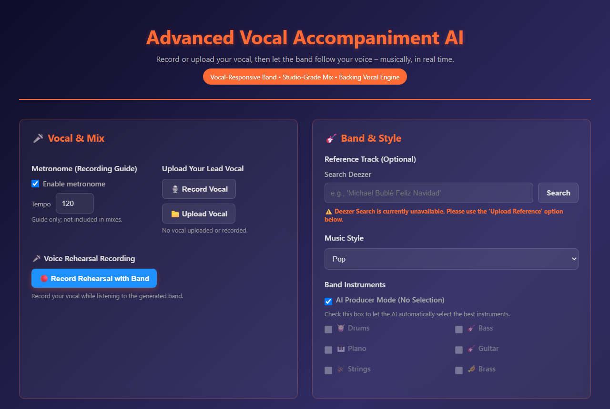

# Vocal Accompaniment AI

**Sing a melody and it builds a band around your voice.** The app works out your key, tempo and style, writes drums, bass, keys and more that follow your phrasing, then mixes and masters the result into a finished track.



## What it does

1. **Record or upload a vocal**: record in the browser with an optional metronome, or upload a file.
2. **Analyse it**: cleans the vocal, then detects **key and scale**, **tempo**, energy and brightness, and guesses the **genre** (pop, rock, R&B, jazz, gospel, ballad, afrobeat, reggae).
3. **Choose the band**: in *AI Producer* mode the app picks the instruments and arrangement complexity for the genre and tempo, or you can pick them yourself.
4. **Arrange around the voice**: writes a chord progression in your key, then builds MIDI parts that follow the vocal.
5. **Render**: plays the MIDI with FluidSynth and the bundled GeneralUser GS soundfont. Alternatively, it can separate a reference song you supply into stems with Demucs.
6. **Vocal effects**: doubling, reverb, echo and harmony, or a one-click *full backup* setting.
7. **Mix and master**: separate EQ for the vocal and the band, mix profiles (e.g. *vocal forward*), multiband compression, limiting, normalisation to **−14 LUFS** and stereo widening. You download a WAV.

## Tech

Python · FastAPI · librosa · NumPy/SciPy · pretty_midi · FluidSynth · Demucs (optional) · vanilla HTML/JS front end

```
app/
  main.py                          FastAPI app and the full generation pipeline
  audio_processing.py              Vocal clean-up, key/scale detection, vocal FX
  vocal_analyzer.py                Tempo, energy and genre detection
  arrangement_selector.py          "AI producer": instruments and complexity per genre
  chord_progression_generator.py   Progressions in the detected key
  arrangement_engine.py            MIDI band parts that follow the vocal
  mixing.py                        Mix and mastering chain
  reference.py                     Reference-track stem separation (Demucs)
  soundfonts/GeneralUser-GS.sf2    Instrument sounds
static/index.html                  Web interface
```

## API

| Method | Path | Purpose |
|---|---|---|
| `POST` | `/analyze-vocal` | Upload a vocal. Returns key, scale, tempo, genre probabilities and a suggested arrangement. |
| `POST` | `/generate-with-instruments` | Upload a vocal, plus instruments/style or a reference track. Returns the mixed and mastered WAV. |
| `GET` | `/health` | Health check |

## Run it locally

Requires Python 3.11+ and [FluidSynth](https://www.fluidsynth.org/) on your `PATH` (`brew install fluid-synth`, `apt install fluidsynth`, or the Windows release zip).

```bash
python -m venv .venv
source .venv/bin/activate          # Windows: .venv\Scripts\activate
pip install -r requirements.txt
uvicorn app.main:app --reload
```

Then open http://localhost:8000.

To use a different soundfont, set `SOUNDFONT_PATH`. For reference-track stem separation, also run `pip install demucs`, which downloads PyTorch.

## Roadmap

- Hosted demo
- More genres and instrument voicings
- Deezer reference search (currently disabled in the UI)

---

Built by [jossy450](https://github.com/jossy450) · [Mighty Sky Tech](https://mightyskytech.com)
